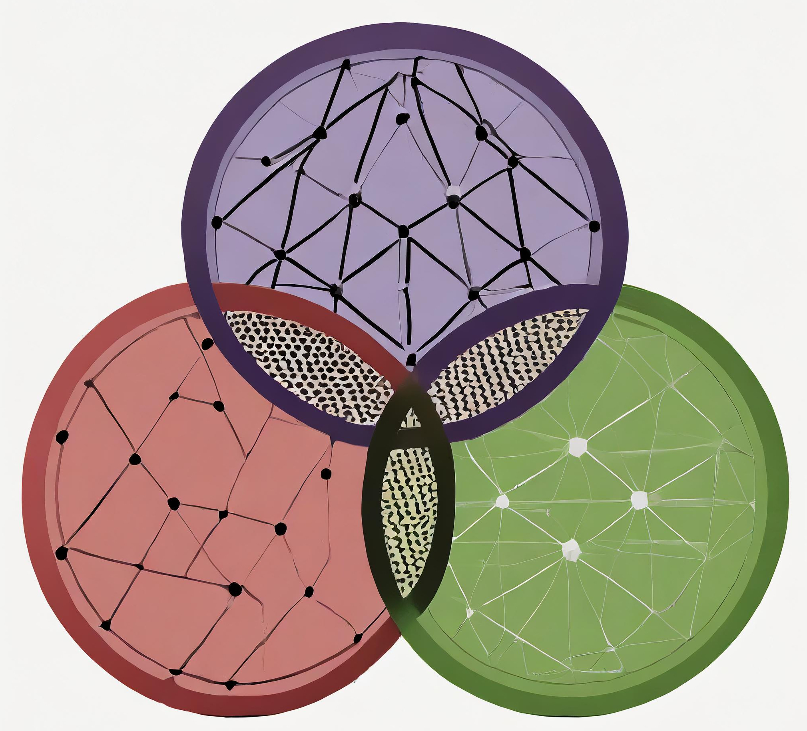
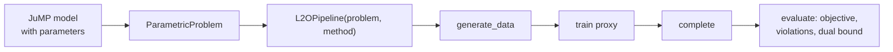

<div style="overflow: auto;">
    <h1 style="float: left;">LearningToOptimize.jl</h1>
    <div style="float: right; margin-left: 20px;">
      
    </div>
</div>

[](https://github.com/LearningToOptimize/LearningToOptimize.jl/actions/workflows/CI.yml?query=branch%3Amain)
[](https://LearningToOptimize.github.io/LearningToOptimize.jl/dev/)
[](https://codecov.io/gh/LearningToOptimize/LearningToOptimize.jl)
[](https://github.com/JuliaTesting/Aqua.jl)
[](https://github.com/aviatesk/JET.jl)

**LearningToOptimize.jl** trains *optimization proxies*: machine-learning models that map the parameters of a
parametric optimization problem, written in JuMP, to (near-)optimal primal and/or dual solutions, orders of magnitude
faster than a solver. It provides the shared layer that every learning-to-optimize (L2O) method needs — a problem
wrapper with fixed input/output layouts, dataset generation, batched evaluation of objectives, violations and dual
bounds — so that a new method only implements what is specific to it. The reference method shipped here is the
penalty ("soft loss") approach, eq. (2) of [Donti, Rolnick & Kolter, ICLR 2021](https://arxiv.org/abs/2104.12225);
methods with completion steps (feasibility restoration, dual completion) live in sibling packages. See the [survey by Kotary et al. (IJCAI 2021)](https://arxiv.org/abs/2103.16378) for the field, and our
[Hugging Face organization](https://huggingface.co/LearningToOptimize) for datasets, pre-trained models and benchmarks.



## Installation

The API described here is on the development version. The registered LearningToOptimize 1.0.0 predates it
(it has no `L2OCore`, `ParametricProblem` or `L2OPipeline`). Until the next release, install the core
subpackage first and then the main package, on any Julia version from 1.10:

```julia
using Pkg
Pkg.add(url = "https://github.com/LearningToOptimize/LearningToOptimize.jl", subdir = "lib/L2OCore")
Pkg.add(url = "https://github.com/LearningToOptimize/LearningToOptimize.jl")
```

The example below also needs JuMP, HiGHS and Flux: `Pkg.add(["JuMP", "HiGHS", "Flux"])`.

## Minimal example

```julia
using LearningToOptimize, JuMP, HiGHS, Flux, Random

model = Model()
@variable(model, d[1:2] in MOI.Parameter.([1.0, 2.0]))   # parameters
@variable(model, 0 <= g[1:3] <= 4)
@constraint(model, g[1] + g[2] == d[1])
@constraint(model, g[3] == d[2])
@objective(model, Min, g[1] + 3g[2] + 2g[3])

problem = ParametricProblem(model)                       # detects LinearConic
pipe = L2OPipeline(problem, PenaltyMethod())
sampler = BoxSampler([0.5, 1.0], [1.5, 2.0])
train = generate_data(pipe; sampler, n = 128)            # self-supervised: parameters only
test = generate_data(pipe; sampler, n = 32, optimizer = HiGHS.Optimizer)

proxy = Flux.f64(Chain(Dense(2 => 32, relu), Dense(32 => 3)))
train_flux!(pipe, proxy, train; epochs = 200, optimiser = Flux.Optimisers.Adam(1e-2))

prediction = complete(pipe, test.inputs, proxy(test.inputs))
evaluate(pipe, test.inputs, prediction)                  # objective, violations, gaps
```

## What you need to provide

- A JuMP model whose instance data are parameters (`@variable(model, p in MOI.Parameter(value))`).
- A parameter distribution: `BoxSampler`, `ScaledSampler`, or any function `(rng, n) -> matrix`.
- A proxy: any callable mapping a `num_parameters × batch` matrix to the method's output (Flux, Lux, plain Julia).
- A solver, only for methods (or evaluations) that need labels or reference optima.

## Solver-labeled datasets

The package also writes datasets of solver solutions to CSV or Arrow files: a `ProblemIterator` holds the
parameter values, a `Recorder` chooses what to save, and `solve_batch` solves every instance. Besides
LearningToOptimize, this needs JuMP and HiGHS.

```julia
using LearningToOptimize, JuMP, HiGHS

model = Model(HiGHS.Optimizer)
set_silent(model)
@variable(model, x)
p = @variable(model, p in MOI.Parameter(1.0))
@constraint(model, cons, x + p >= 3)
@objective(model, Min, 2x)

problem_iterator = ProblemIterator(Dict(p => collect(1.0:10.0)))
recorder = Recorder{CSVFile}("output_file"; primal_variables = [x], dual_variables = [cons])
solve_batch(problem_iterator, recorder)
```

This writes one row per solved instance (its id, primal and dual values, objective, solve time and status)
to `output_file.csv`. The [dataset generation guide](https://LearningToOptimize.github.io/LearningToOptimize.jl/dev/datasetgen/)
covers samplers, Arrow files and training Flux or MLJ models on the saved data.

## The LearningToOptimize ecosystem

| Package | What it provides |
|:--|:--|
| [LearningToOptimize.jl](https://github.com/LearningToOptimize/LearningToOptimize.jl) | the penalty method, Flux training and solver-labeled dataset generation; hosts the two subpackages below |
| ↳ [L2OCore](https://github.com/LearningToOptimize/LearningToOptimize.jl/tree/main/lib/L2OCore) | the shared interface: method families, problem wrapper, batched evaluators, datasets |
| ↳ [L2OSobolev](https://github.com/LearningToOptimize/LearningToOptimize.jl/tree/main/lib/L2OSobolev) | derivative (Sobolev) supervision added to any method |
| [L2ODLL.jl](https://github.com/LearningToOptimize/L2ODLL.jl) | Dual Lagrangian Learning: dual proxies that give valid dual bounds for conic problems |
| [L2ODC3.jl](https://github.com/LearningToOptimize/L2ODC3.jl) | DC3: equality completion and inequality correction for primal proxies |
| [L2OALM.jl](https://github.com/LearningToOptimize/L2OALM.jl) | primal-dual learning with an augmented Lagrangian |

How the pieces fit, and how to add a method, is explained in the [design page](https://LearningToOptimize.github.io/LearningToOptimize.jl/dev/design/).

## Derivative (Sobolev) supervision

[`lib/L2OSobolev`](lib/L2OSobolev) adds masked Sobolev training
([Rosemberg et al., NeurIPS 2026](https://andrewrosemberg.github.io/NeurIPS2026-Masked-Sobolev-Optimization-Proxies/))
to any method: the proxy also matches randomly selected entries of the solver sensitivities ∂x*/∂p,
obtained by implicit differentiation of the KKT conditions with DiffOpt.jl.

```julia
using L2OCore, L2OSobolev
method = SobolevRegularized(SupervisedMSE(); weight = 1.0, mask = RandomMask(0.1), backend = LuxNestedAD())
```

wraps value supervision; any other primal or primal-dual method can be wrapped the same way. Install it with
`Pkg.add(url = "https://github.com/LearningToOptimize/LearningToOptimize.jl", subdir = "lib/L2OSobolev")` after
L2OCore. A complete, runnable example with Lux is in the [L2OSobolev README](lib/L2OSobolev/README.md); for
Flux models use `backend = ZygoteNestedAD()`.

See the [Sobolev theory page](https://LearningToOptimize.github.io/LearningToOptimize.jl/dev/sobolev/theory/) and
the [package guide](https://LearningToOptimize.github.io/LearningToOptimize.jl/dev/sobolev/guide/).

## Background

Parametric optimization problems arise when certain elements (e.g., coefficients, constraints) may vary according to problem parameters. A general form of a parameterized convex optimization problem is 

$$
\begin{aligned}
&\min_{x} \quad f(x; \theta) \\
&\text{subject to} \quad g_i(x; \theta) \leq 0, \quad i = 1,\dots, m \\
&\quad\quad\quad\quad A(\theta)x = b(\theta)
\end{aligned}
$$

where $\theta$ is the parameter.

**Learning to Optimize (L2O)** is an emerging paradigm where machine learning models *learn* to solve optimization problems efficiently. This approach is also known as **optimization proxies** or **amortized optimization**. 

In more technical terms, **amortized optimization** seeks to learn a function $f_\theta(x)$ that maps problem parameters $x$ to solutions $y$ that (approximately) minimize a given objective function subject to constraints. Modern methods leverage techniques like **differentiable optimization layers**, **input-convex neural networks**, or constraint-enforcing architectures (e.g., [DC3](https://openreview.net/pdf?id=0Ow8_1kM5Z)) to ensure that the learned proxy solutions are both feasible and performant. By coupling the solver and the model in an **end-to-end** pipeline, these approaches let the training objective directly reflect downstream metrics, improving speed and reliability.

Recent advances also focus on **trustworthy** proxies, whose outputs satisfy the constraints or come with valid performance bounds by construction. This is crucial in domains like energy systems or manufacturing, where infeasible solutions can have large penalties or safety concerns. Overall, learning-based optimization frameworks aim to combine the advantages of ML (data-driven generalization) with the rigor of mathematical programming (constraint handling and optimality).

For a broader overview, see the [SIAM News article on trustworthy optimization proxies](https://www.siam.org/publications/siam-news/articles/fusing-artificial-intelligence-and-optimization-with-trustworthy-optimization-proxies/), which highlights the growing synergy between AI and classical optimization.

## Citation

If you use LearningToOptimize.jl, please cite it using the metadata in [`CITATION.cff`](CITATION.cff).
