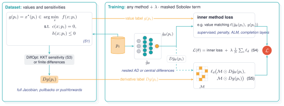

<div align="center">


# LearningToOptimize.jl

<p><sub><b>PARAMETRIC DATASETS · SENSITIVITY LABELS · OPTIMIZATION PROXIES</b></sub></p>

[](https://github.com/LearningToOptimize/LearningToOptimize.jl/actions/workflows/CI.yml?query=branch%3Amain) [](https://LearningToOptimize.github.io/LearningToOptimize.jl/dev/) [](https://codecov.io/gh/LearningToOptimize/LearningToOptimize.jl) [](https://github.com/JuliaTesting/Aqua.jl) [](https://github.com/aviatesk/JET.jl)

</div>

<p align="center">
  <picture>
    <source media="(max-width: 640px)" srcset="docs/src/assets/diagrams/learningtooptimize--method-compact.svg">
    
  </picture>
</p>
<p align="center"><i>A proxy maps the parameters of a JuMP model to a raw output; each method turns that output into a training loss, or completes it into a prediction at inference, with optional repair layers.</i></p>

**LearningToOptimize.jl** trains *optimization proxies*: machine-learning models that map the parameters of a parametric optimization problem, written in JuMP, to (near-)optimal primal and/or dual solutions, orders of magnitude faster than a solver. It provides the layer every learning-to-optimize (L2O) method shares (a problem wrapper with fixed input and output layouts, dataset generation, and batched evaluation of objectives, violations and dual bounds), so a new method implements only what is specific to it.

The reference method shipped here is the penalty ("soft loss") approach, eq. (2) of [Donti, Rolnick & Kolter, ICLR 2021](https://arxiv.org/abs/2104.12225); methods with completion steps (feasibility restoration, dual completion) live in sibling packages. See the [survey by Kotary et al. (IJCAI 2021)](https://arxiv.org/abs/2103.16378) for the field, and the [Hugging Face organization](https://huggingface.co/LearningToOptimize) for datasets, pre-trained models and benchmarks.

## Installation

The API described here is on the development version. The registered LearningToOptimize 1.0.0 predates it
(it has no `L2OCore`, `ParametricProblem` or `L2OPipeline`). Until the next release, install the core
subpackage first and then the main package, on any Julia version from 1.10:

```julia
using Pkg
Pkg.add(url = "https://github.com/LearningToOptimize/LearningToOptimize.jl", subdir = "lib/L2OCore")
Pkg.add(url = "https://github.com/LearningToOptimize/LearningToOptimize.jl")
```

The example below also needs JuMP, HiGHS and Flux: `Pkg.add(["JuMP", "HiGHS", "Flux"])`.

## Minimal example

```julia
using LearningToOptimize, JuMP, HiGHS, Flux, Random

model = Model()
@variable(model, d[1:2] in MOI.Parameter.([1.0, 2.0]))   # parameters
@variable(model, 0 <= g[1:3] <= 4)
@constraint(model, g[1] + g[2] == d[1])
@constraint(model, g[3] == d[2])
@objective(model, Min, g[1] + 3g[2] + 2g[3])

problem = ParametricProblem(model)                       # detects LinearConic
pipe = L2OPipeline(problem, PenaltyMethod())
sampler = BoxSampler([0.5, 1.0], [1.5, 2.0])
train = generate_data(pipe; sampler, n = 128)            # self-supervised: parameters only
test = generate_data(pipe; sampler, n = 32, optimizer = HiGHS.Optimizer)

proxy = Flux.f64(Chain(Dense(2 => 32, relu), Dense(32 => 3)))
train_flux!(pipe, proxy, train; epochs = 200, optimiser = Flux.Optimisers.Adam(1e-2))

prediction = complete(pipe, test.inputs, proxy(test.inputs))
evaluate(pipe, test.inputs, prediction)                  # objective, violations, gaps
```

## What you need to provide

| | what | examples |
|:--|:--|:--|
| problem | a JuMP model whose instance data are parameters | `@variable(model, p in MOI.Parameter(value))` |
| parameter distribution | a sampler | `BoxSampler`, `ScaledSampler`, or any function `(rng, n) -> matrix` |
| proxy | any callable from a `num_parameters × batch` matrix to the method's output | Flux, Lux, plain Julia |
| solver | only for methods (or evaluations) that need labels or reference optima | HiGHS, Ipopt, any JuMP solver |

## Solver-labeled datasets

The package also writes datasets of solver solutions to CSV or Arrow files: a `ProblemIterator` holds the
parameter values, a `Recorder` chooses what to save, and `solve_batch` solves every instance. Besides
LearningToOptimize, this needs JuMP and HiGHS.

```julia
using LearningToOptimize, JuMP, HiGHS

model = Model(HiGHS.Optimizer)
set_silent(model)
@variable(model, x)
p = @variable(model, p in MOI.Parameter(1.0))
@constraint(model, cons, x + p >= 3)
@objective(model, Min, 2x)

problem_iterator = ProblemIterator(Dict(p => collect(1.0:10.0)))
recorder = Recorder{CSVFile}("output_file"; primal_variables = [x], dual_variables = [cons])
solve_batch(problem_iterator, recorder)
```

This writes one row per solved instance (its id, primal and dual values, objective, solve time and status)
to `output_file.csv`. The [dataset generation guide](https://LearningToOptimize.github.io/LearningToOptimize.jl/dev/datasetgen/)
covers samplers, Arrow files and training Flux or MLJ models on the saved data.

## The LearningToOptimize ecosystem

| Package | What it provides |
|:--|:--|
| [LearningToOptimize.jl](https://github.com/LearningToOptimize/LearningToOptimize.jl) | the penalty method, Flux training and solver-labeled dataset generation; hosts the two subpackages below |
| ↳ [L2OCore](https://github.com/LearningToOptimize/LearningToOptimize.jl/tree/main/lib/L2OCore) | the shared interface: method families, problem wrapper, batched evaluators, datasets |
| ↳ [L2OSobolev](https://github.com/LearningToOptimize/LearningToOptimize.jl/tree/main/lib/L2OSobolev) | derivative (Sobolev) supervision added to any method |
| [L2ODLL.jl](https://github.com/LearningToOptimize/L2ODLL.jl) | Dual Lagrangian Learning: dual proxies that give valid dual bounds for conic problems |
| [L2ODC3.jl](https://github.com/LearningToOptimize/L2ODC3.jl) | DC3: equality completion and inequality correction for primal proxies |
| [L2OALM.jl](https://github.com/LearningToOptimize/L2OALM.jl) | primal-dual learning with an augmented Lagrangian |

How the pieces fit, and how to add a method, is explained in the [design page](https://LearningToOptimize.github.io/LearningToOptimize.jl/dev/design/).

## Derivative (Sobolev) supervision

[`lib/L2OSobolev`](lib/L2OSobolev) adds masked Sobolev training
([Rosemberg et al., NeurIPS 2026](https://andrewrosemberg.github.io/NeurIPS2026-Masked-Sobolev-Optimization-Proxies/))
to any method: the proxy also matches randomly selected entries of the solver sensitivities ∂x*/∂p,
obtained by implicit differentiation of the KKT conditions with DiffOpt.jl.

<p align="center">
  
</p>

```julia
using L2OCore, L2OSobolev
method = SobolevRegularized(SupervisedMSE(); weight = 1.0, mask = RandomMask(0.1), backend = LuxNestedAD())
```

wraps value supervision; any other primal or primal-dual method can be wrapped the same way. Install it with
`Pkg.add(url = "https://github.com/LearningToOptimize/LearningToOptimize.jl", subdir = "lib/L2OSobolev")` after
L2OCore. A complete, runnable example with Lux is in the [L2OSobolev README](lib/L2OSobolev/README.md); for
Flux models use `backend = ZygoteNestedAD()`.

See the [Sobolev theory page](https://LearningToOptimize.github.io/LearningToOptimize.jl/dev/sobolev/theory/) and
the [package guide](https://LearningToOptimize.github.io/LearningToOptimize.jl/dev/sobolev/guide/).

## Background

A parametric optimization problem maps parameters $p$ to an instance $\min_x f(x; p)$ subject to $g_i(x; p) \in \mathcal{S}_i$; learning to optimize (also called optimization proxies or amortized optimization) trains a model $\phi_\theta$ that maps $p$ to a (near-)optimal solution, so that a forward pass replaces a solve. Methods differ in how they handle the constraints: penalties in the loss, completion and correction layers (e.g. [DC3](https://openreview.net/pdf?id=0Ow8_1kM5Z)), dual proxies with valid bounds, or primal-dual training. The [Theory page](https://LearningToOptimize.github.io/LearningToOptimize.jl/dev/theory/) states the notation and the mathematics; the [SIAM News article](https://www.siam.org/publications/siam-news/articles/fusing-artificial-intelligence-and-optimization-with-trustworthy-optimization-proxies/) gives a broader overview of the field.

## Citation

If you use LearningToOptimize.jl, please cite it using the metadata in [`CITATION.cff`](CITATION.cff).
