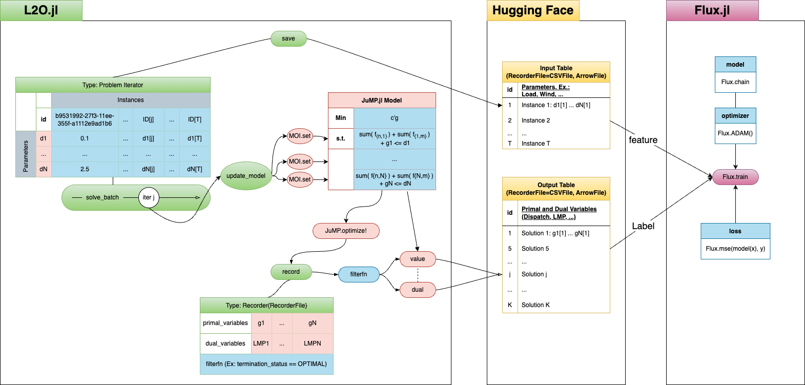

# Dataset generation with solver labels

```@meta
CurrentModule = LearningToOptimize
```

Besides the method-dispatched [`generate_data`](@ref L2OCore.generate_data),
LearningToOptimize writes datasets of solver solutions to CSV or Arrow files.
The workflow has three parts: a [`ProblemIterator`](@ref) holds the parameter
values of every instance, a [`Recorder`](@ref) chooses what to save, and
[`solve_batch`](@ref) solves every instance and writes one row per successful
solve. Every instance gets a UUID, which links input and output files.



The code on this page runs as one script in an environment with
LearningToOptimize, JuMP, HiGHS, CSV, DataFrames, Flux, MLJ, MLJFlux and
Optimisers.

## The problem iterator

```julia
using LearningToOptimize, JuMP, HiGHS

model = Model(HiGHS.Optimizer)
set_silent(model)
@variable(model, x)
p = @variable(model, p in MOI.Parameter(1.0))
@constraint(model, cons, x + p >= 3)
@objective(model, Min, 2x)

parameter_values = Dict(p => collect(1.0:10.0))
problem_iterator = ProblemIterator(parameter_values)
```

Save the parameter values of the iterator with

```julia
save(problem_iterator, "input_file", CSVFile)
```

which writes `input_file.csv`:

| id | p |
|:--|--:|
| `1d08db14-…` | 1.0 |
| `1d08db70-…` | 2.0 |
| … | … |
| `1d08dc2e-…` | 10.0 |

`load("input_file", CSVFile)` reads the file back as a `DataFrame`.

## Samplers

Instead of listing parameter values by hand, sample them around the current
values of the parameters with the predefined samplers (`box_sampler`,
`line_sampler`, `scaled_distribution_sampler`) or with your own function that
takes the vector of parameters and returns a matrix with one row per
parameter and one column per instance. [`general_sampler`](@ref) combines
several samplers. Given a model file that JuMP's `read_from_file` can read
(tested with MathOptFormat), it samples the parameters and saves them:

```julia
write_to_file(model, "model.mof.json")
sampled_iterator = general_sampler(
    "model.mof.json";
    samplers = [
        (original_parameters) -> scaled_distribution_sampler(original_parameters, 100),
        (original_parameters) -> line_sampler(original_parameters, 1.01:0.01:1.25),
        (original_parameters) -> box_sampler(original_parameters, 30),
    ],
    save_file = "sampled_input",
    filetype = CSVFile,
)
```

The result is a `ProblemIterator` whose parameter values are also in
`sampled_input.csv`.

## The recorder

Choose what to record and solve every instance:

```julia
recorder = Recorder{CSVFile}("output_file"; primal_variables = [x], dual_variables = [cons])
solve_batch(problem_iterator, recorder)
```

This writes `output_file.csv`, one row per successful solve:

| id | x | dual_cons | objective | time | status | primal_status | dual_status |
|:--|--:|--:|--:|--:|:--|:--|:--|
| `1d08db14-…` | 2.0 | 2.0 | 4.0 | 0.0002 | OPTIMAL | FEASIBLE\_POINT | FEASIBLE\_POINT |
| `1d08db70-…` | 1.0 | 2.0 | 2.0 | 0.0001 | OPTIMAL | FEASIBLE\_POINT | FEASIBLE\_POINT |
| … | … | … | … | … | … | … | … |

To write Arrow files instead, use `Recorder{ArrowFile}`; see
[Reading from and compressing Arrow files](arrow.md).

## Training a proxy on the saved data

With Flux, join inputs and outputs on the instance id (only successful solves
have an output row) and train in Flux's explicit style:

```julia
using CSV, DataFrames, Flux

input_data = CSV.read("input_file.csv", DataFrame)
output_data = CSV.read("output_file.csv", DataFrame)
data = innerjoin(input_data, output_data; on = :id)

X = Matrix{Float32}(data[!, [:p]])'             # parameters × instances
Y = Matrix{Float32}(data[!, [:x, :dual_cons]])' # predicted solution × instances

nn = Chain(Dense(size(X, 1) => 64, relu), Dense(64 => 32, relu), Dense(32 => size(Y, 1)))
opt_state = Flux.setup(Flux.Adam(1e-2), nn)
for epoch = 1:200
    Flux.train!((m, x, y) -> Flux.mse(m(x), y), nn, [(X, Y)], opt_state)
end
predictions = nn(X)
```

With MLJ, use the `MultitargetNeuralNetworkRegressor` of MLJFlux and the
`FullyConnectedBuilder` of this package:

```julia
using MLJ, MLJFlux, Optimisers

input_features = data[!, [:p]]
output_variables = data[!, [:x, :dual_cons]]
regressor = MultitargetNeuralNetworkRegressor(;
    builder = FullyConnectedBuilder([64, 32]),
    rng = 123,
    epochs = 20,
    optimiser = Optimisers.Adam(),
)
mach = machine(regressor, input_features, output_variables)
fit!(mach; verbosity = 0)
predict(mach, input_features)
```

## Evaluating the proxy

[`general_evaluator`](@ref) evaluates a trained MLJ machine on the instances
of a `ProblemIterator`. It returns a `NamedTuple` with the objective value and
the infeasibility of the predicted solution for each instance, and the total
inference time and allocated memory.

```julia
evaluation = general_evaluator(problem_iterator, mach)
```
