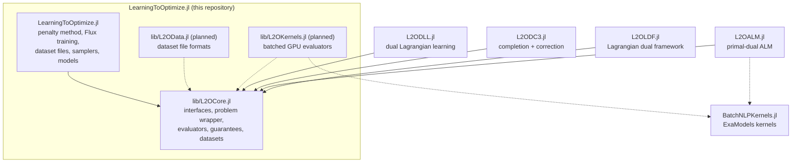
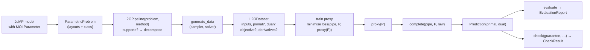
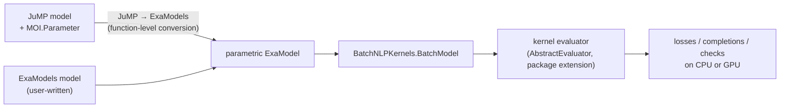

# Design of the LearningToOptimize ecosystem

This page explains how the code is organised and why. The goal is that
**implementing a new learning-to-optimize (L2O) method takes only the code
that is specific to that method**. Data generation, evaluation, feasibility
and duality checks, samplers and dataset conventions are shared.

## Packages



| package | role | dependencies |
|:--|:--|:--|
| `L2OCore` (`lib/L2OCore`) | method hierarchy, problem classes, `ParametricProblem`, evaluators, guarantees, datasets, method-dispatched pipeline | JuMP, MathOptInterface, LinearAlgebra, SparseArrays, Random |
| `LearningToOptimize` | the penalty method, Flux training loop, existing dataset generation (`ProblemIterator`, recorders, samplers), `FullyConnected` models; re-exports `L2OCore` | `L2OCore` + ML and file-format stack |
| method packages (`L2ODLL`, `L2ODC3`, `L2OALM`, `L2OLDF`, …) | one method family member each | `L2OCore` only (plus what the method itself needs) |
| `L2OKernels` (planned) | batched GPU evaluators as an `AbstractEvaluator` backend | ExaModels / BatchNLPKernels, loaded as a package extension |

**Why a `lib/` subpackage instead of a separate repository?** The core and
the reference method evolve together while the interface settles; one
repository gives one CI run, one documentation site and atomic changes.
Method packages live in their own repositories because they have their own
authors, papers and dependency stacks.

**Why so few dependencies in `L2OCore`?** Method packages must be able to
depend on it without inheriting Flux, MLJ, CSV or Arrow. Everything heavy is
either in the main package or behind package extensions.

### Subpackage mechanism and Julia versions

Julia ≥ 1.11 resolves unregistered local packages from a `[sources]` section
in `Project.toml`; Julia 1.10 (the LTS) ignores that section. We support both:

- `Project.toml` declares `[sources] L2OCore = {path = "lib/L2OCore"}` (used on 1.11+);
- CI runs `Pkg.develop(path = "lib/L2OCore")` before testing on every version,
  which is what makes 1.10 work and is harmless on 1.11+;
- `lib/L2OCore` has its own `Project.toml`, test suite and CI job.

Once `L2OCore` is registered, `[sources]` and the `develop` step can be
removed; `[compat] L2OCore = "0.1"` already pins the interface version.

### Documentation for `lib/` packages

There is one Documenter site. `docs/make.jl` loads both modules
(`modules = [LearningToOptimize, L2OCore]`) and the API reference has one
section per package, so cross-references between the core and the main
package work and there is a single place to search.

## Type hierarchy

```mermaid
classDiagram
    class AbstractL2OMethod
    class AbstractPrimalMethod
    class AbstractDualMethod
    class AbstractPrimalDualMethod
    class AbstractMethodWrapper
    AbstractL2OMethod <|-- AbstractPrimalMethod
    AbstractL2OMethod <|-- AbstractDualMethod
    AbstractL2OMethod <|-- AbstractPrimalDualMethod
    AbstractL2OMethod <|-- AbstractMethodWrapper
    AbstractPrimalMethod <|-- PenaltyMethod
    AbstractPrimalMethod <|-- DC3
    AbstractPrimalMethod <|-- LDF
    AbstractDualMethod <|-- DLL
    AbstractPrimalDualMethod <|-- ALM

    class AbstractProblemClass
    class AbstractConvexClass
    AbstractProblemClass <|-- AbstractConvexClass
    AbstractConvexClass <|-- LinearConic
    AbstractConvexClass <|-- ConvexQuadratic
    AbstractProblemClass <|-- SmoothNonlinear
    AbstractProblemClass <|-- MixedInteger

    class AbstractGuarantee
    AbstractGuarantee <|-- NoGuarantee
    AbstractGuarantee <|-- Feasible
    AbstractGuarantee <|-- EqualityFeasible
    AbstractGuarantee <|-- BoundFeasible
    AbstractGuarantee <|-- ValidDualBound

    class AbstractEvaluator
    AbstractEvaluator <|-- MatrixEvaluator
    AbstractEvaluator <|-- JuMPEvaluator
    AbstractEvaluator <|-- BatchKernelEvaluator_planned
```



- **Families** (`AbstractPrimalMethod`, `AbstractDualMethod`,
  `AbstractPrimalDualMethod`) select fallbacks: what is predicted, which labels
  are generated, how the raw output is split.
- **Problem classes** are traits of the problem, detected from the JuMP model
  (`detect_problem_class`) or given explicitly. They exist so that a method can
  state *where its guarantees hold*.
- **Guarantees** are named properties of completed predictions. Each has a
  numerical `check`; the names are the anchors for formal proofs later.
- **Evaluators** are interchangeable backends for batched objective,
  constraint, violation and dual-bound evaluation.
- **Wrappers** (`AbstractMethodWrapper`) add behaviour to *any* method
  (e.g. derivative supervision) by forwarding everything to an inner method and
  adding a loss term.

## Data flow



Layouts are fixed once by `ParametricProblem`:

| quantity | shape | order |
|:--|:--|:--|
| inputs `P` | `num_parameters × B` | `parameters(problem)` (creation order) |
| primal `X` | `num_decision_variables × B` | `decision_variables(problem)` |
| dual `Y` | `num_duals × B` | `constraint_refs(problem)`, rows `dual_layout(problem)[i]`, signs of `JuMP.dual` |

**Batch-first** (batch = last dimension) matches Flux, Lux and
BatchNLPKernels and keeps every per-instance quantity a contiguous column.

## Method lifecycle

```mermaid
sequenceDiagram
    participant U as user
    participant P as L2OPipeline
    participant M as method package
    participant C as L2OCore fallbacks
    U->>P: L2OPipeline(problem, method)
    P->>M: supports(method, class)?
    alt not supported
        P-->>U: UnsupportedProblemError
    end
    P->>M: decompose(problem, method)
    M-->>C: (fallback by family)
    U->>P: generate_data(pipe; sampler, n)
    P->>M: generate_data(method, pipe; …)
    loop training
        U->>P: loss(pipe, P, proxy(P); targets, proxy)
        P->>M: loss(method, pipe, …)
    end
    U->>P: complete(pipe, P, proxy(P))
    U->>P: evaluate / check(guarantees(method)…)
```

What a method package writes:

| function | required? | fallback |
|:--|:--|:--|
| `struct M <: Abstract*Method` | yes | — |
| `supports(::M, ::Class) = true` | yes, per class | `false` (no silent fallback) |
| `guarantees(::M)` | if any | `(NoGuarantee(),)` |
| `decompose(problem, ::M)` | if the method predicts a subset | `FullSpaceDecomposition` by family |
| `generate_data(::M, pipe; …)` | if labels differ | sample + solve, labels by family |
| `complete(::M, pipe, P, raw)` | if there is a completion/repair | split raw output |
| `loss(::M, pipe, P, raw; …)` | if not supervised MSE | supervised MSE |

**Why `supports` is opt-in.** A method's guarantees are theorems with
hypotheses. Running DLL on a nonconvex problem or DC3's correction on
nonlinear constraints silently changes what the output means. The pipeline
therefore refuses unsupported classes up front with an error that names the
guarantees at stake. Users can still override a mis-detected class
explicitly (`ParametricProblem(model; class = …)`).

**Why the pipeline object.** `L2OPipeline` checks support once, computes the
decomposition once (which can be expensive: dualisation, Jacobian
factorisations) and holds the evaluator. It replaces hidden caches stored in
`model.ext`. Extension functions take `(method, pipe, …)` so packages dispatch
on their own method type; fallbacks leave the other arguments untyped so these
definitions are never ambiguous.

## Methods at a glance

| method | family | classes (assumptions) | guarantees | reference |
|:--|:--|:--|:--|:--|
| `PenaltyMethod` (this package) | primal | `LinearConic`, `ConvexQuadratic` | `NoGuarantee` | soft loss, eq. (2) of Donti et al. 2021 |
| DLL (`L2ODLL.jl`) | dual | conic (`LinearConic`, `ConvexQuadratic`) with a completable decomposition | `ValidDualBound` | Tanneau & Van Hentenryck 2024; Klamkin et al. 2024 |
| DC3 (`L2ODC3.jl`) | primal | equality constraints with an invertible Jacobian block | `EqualityFeasible` (inequalities: only in the limit for linear constraints) | Donti et al. 2021 |
| ALM / PDL (`L2OALM.jl`) | primal-dual | smooth problems, kernels for batched evaluation | `NoGuarantee` (feasibility encouraged by the augmented Lagrangian) | Park & Van Hentenryck 2023 |
| LDF (`L2OLDF.jl`) | primal | smooth problems | `NoGuarantee` | Fioretto et al. 2020 |

The guarantee column is what each method package's tests must check
numerically on random instances with `L2OCore.check`.

## Evaluation layer, front ends and GPUs

Every loss and check is expressed through the `AbstractEvaluator` functions
(`batch_objective`, `constraint_values`, `row_violation`, `cone_violation`,
`dual_bound`). Two backends ship today:

- `MatrixEvaluator`: extracts `A, B, b, Q, c, H` once; every batch operation
  is a sparse-dense product or broadcast. It is differentiable with array AD
  and element-type generic. Moving its arrays to a GPU (`Adapt`) is the planned
  `L2OCore` extension for linear/quadratic problems.
- `JuMPEvaluator`: per-instance reference through `JuMP.value`; it is the
  ground truth in tests, never used in training loops.

The plan for nonlinear problems and for an **ExaModels front end** is a single
kernel backend:



- Problems stated in JuMP or directly in ExaModels end up as a parametric
  `ExaModel`; a `BatchModel` from BatchNLPKernels provides batched objective,
  constraints, Jacobian products and violations with `ChainRulesCore` rules.
- A kernel evaluator implementing the `AbstractEvaluator` functions on top of
  a `BatchModel` plugs into every method unchanged. It lives in a package
  extension (`L2OCore` + `BatchNLPKernels`), keeping the core light.
- An ExaModels front end subtypes `AbstractParametricProblem` (which
  `ParametricProblem` already does), implementing the layout functions,
  `objective_sign` and `default_evaluator`.
- Batched solvers can label data much faster than a loop over `optimize!`;
  a batched-modelling layer (batched parameters/constraints over JuMP, with a
  bridge to ExaModels and NLPModels) would let `solve_instances` hand a whole
  batch to such solvers. This is tracked as a follow-up issue.

CI runs on CPU. GPU paths are written without scalar indexing and are
testable by running the same tests with arrays adapted to the device.

## Machine-learning frameworks

`L2OCore` is framework-agnostic: a proxy is any callable on a batch. The main
package ships a Flux training loop (`train_flux!`) because Flux is already a
dependency. Derivative (Sobolev) supervision needs *nested* AD: an
input-Jacobian product of the proxy inside the loss, then a gradient with
respect to the weights. We measured which combinations give correct gradients
(compared with central finite differences) on a two-layer network:

```@raw html
<!-- NESTED_AD_TABLE -->
```

Decision: method packages must work with any callable proxy; **Lux is the
tested path for losses that need nested AD**, and the Flux loop in the main
package is supported for first-order losses (penalty, supervised, ALM-type
losses).

## Datasets and trained models on the Hugging Face Hub

Datasets and trained proxies are shared under
`huggingface.co/LearningToOptimize`. Proposed conventions (design only):

**Dataset card fields**

| field | example | why |
|:--|:--|:--|
| `problem_id`, `problem_version` | `pglib_opf_case5_pjm/DCPPowerModel`, `1.0` | reproducible problem identity |
| `problem_file` | `.mof.json` with parameters | the JuMP model, readable by `MOI.FileFormats` |
| `parameter_sampler` | `{"type": "ScaledSampler", "low": 0.8, "high": 1.2}` (issue #32) | inputs distribution, needed to generate more data |
| `layouts` | names of parameters, variables, constraints in order | ties columns to model entities |
| `solver`, `solver_version`, `tolerances` | `HiGHS 1.x`, `primal_feas = 1e-7` | label quality |
| `labels` | `primal`, `dual`, `objective`, `status`, optional `derivatives: pullback|jacobian` | what can be trained on |
| `guarantees_satisfied` | `Feasible ≤ 1e-6`, `ValidDualBound` | checked with `L2OCore.check` before upload |
| `splits`, `seed` | `train/val/test`, `42` | comparability |

**Model card fields**: `method` (type and hyper-parameters), `proxy`
(architecture, framework, parameter count), `training_data` (dataset id and
revision), `metrics` (`EvaluationReport` means on the test split, gap,
max violation), `guarantees` (from `guarantees(method)` plus their `check`
results).

## Compatibility with the existing API

All existing exports (`ProblemIterator`, `Recorder`, `ArrowFile`, `CSVFile`,
samplers, `FullyConnected`, evaluators) are unchanged. `L2OCore` names are
re-exported. Names that collide with other packages commonly loaded together
(`MLJ.evaluate`) are resolved inside `LearningToOptimize` in favour of the
`L2OCore` meaning; users that load MLJ too can write
`LearningToOptimize.evaluate`.

## Planned work

- Move `ProblemIterator`, recorders and file formats to `lib/L2OData.jl`
  once `L2ODataset` I/O is designed (issue #12), so the main package can drop
  Arrow/CSV/DataFrames for users who only train.
- Kernel evaluator extension and the ExaModels front end (issue #33).
- Graph encoders from the problem structure (issue #29).
