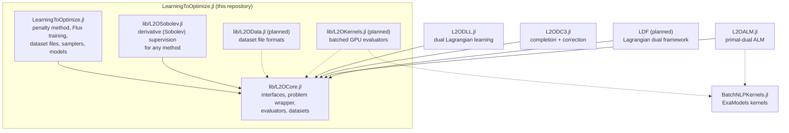
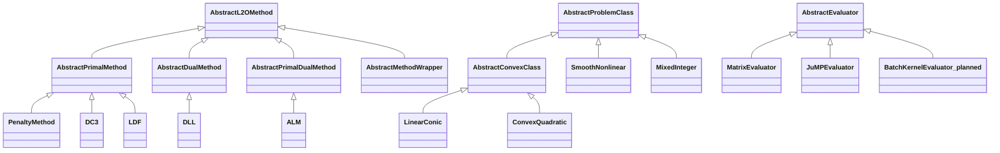

# Design of the LearningToOptimize ecosystem

This page explains how the code is organized and why. The goal is that
**implementing a new learning-to-optimize (L2O) method takes only the code
that is specific to that method**. Data generation, evaluation of
objectives, violations and dual bounds, samplers and dataset conventions are
shared.

## Packages



| package | role | dependencies |
|:--|:--|:--|
| `L2OCore` (`lib/L2OCore`) | method hierarchy, problem classes, `ParametricProblem`, evaluators, datasets, method-dispatched pipeline | JuMP, MathOptInterface, LinearAlgebra, SparseArrays, Random |
| `LearningToOptimize` | the penalty method, Flux training loop, existing dataset generation (`ProblemIterator`, recorders, samplers), `FullyConnected` models; re-exports `L2OCore` | `L2OCore` + ML and file-format stack |
| `L2OSobolev` (`lib/L2OSobolev`) | method-agnostic Sobolev (derivative) supervision: `SobolevRegularized` wrapper, masks, derivative labels from DiffOpt | `L2OCore`, ChainRulesCore; DiffOpt and Lux as package extensions |
| method packages (`L2ODLL`, `L2ODC3`, `L2OALM`, …) | one method family member each | `L2OCore` only (plus what the method itself needs) |
| `L2OKernels` (planned) | batched GPU evaluators as an `AbstractEvaluator` backend | ExaModels / BatchNLPKernels, loaded as a package extension |

**Why a `lib/` subpackage instead of a separate repository?** The core and
the reference method evolve together while the interface settles; one
repository gives one CI run, one documentation site and atomic changes.
Method packages live in their own repositories because they have their own
authors, papers and dependency stacks.

**Why so few dependencies in `L2OCore`?** Method packages must be able to
depend on it without inheriting Flux, MLJ, CSV or Arrow. Everything heavy is
either in the main package or behind package extensions.

### Subpackage mechanism and Julia versions

Julia ≥ 1.11 resolves unregistered local packages from a `[sources]` section
in `Project.toml`; Julia 1.10 (the LTS) ignores that section. We support both:

- `Project.toml` declares `[sources] L2OCore = {path = "lib/L2OCore"}` (used on 1.11+);
- CI runs `Pkg.develop(path = "lib/L2OCore")` before testing on every version,
  which is what makes 1.10 work and is harmless on 1.11+;
- `lib/L2OCore` has its own `Project.toml`, test suite and CI job.

Once `L2OCore` is registered, `[sources]` and the `develop` step can be
removed; `[compat] L2OCore = "0.1"` already pins the interface version.

### Documentation for `lib/` packages

There is one Documenter site. `docs/make.jl` loads both modules
(`modules = [LearningToOptimize, L2OCore]`) and the API reference has one
section per package, so cross-references between the core and the main
package work and there is a single place to search.

## Type hierarchy



- **Families** (`AbstractPrimalMethod`, `AbstractDualMethod`,
  `AbstractPrimalDualMethod`) select fallbacks: what is predicted, which labels
  are generated, how the raw output is split.
- **Problem classes** are traits of the problem, detected from the JuMP model
  (`detect_problem_class`) or given explicitly. They exist so that a method can
  declare which problems its mathematics applies to (`supports`).
- **Evaluators** are interchangeable backends for batched objective,
  constraint, violation and dual-bound evaluation.
- **Wrappers** (`AbstractMethodWrapper`) add behavior to *any* method
  (e.g. derivative supervision) by forwarding everything to an inner method and
  adding a loss term.

## Data flow

```mermaid
flowchart LR
    M["JuMP model<br/>with MOI.Parameter"] --> PP["ParametricProblem<br/>(layouts + class)"]
    PP --> PIPE["L2OPipeline(problem, method)<br/>supports? → decompose"]
    PIPE --> GD["generate_data<br/>(sampler, solver)"]
    GD --> DS["L2ODataset<br/>inputs, primal?, dual?,<br/>objective?, derivatives?"]
    DS --> TR["train proxy<br/>minimize loss(pipe, P, proxy(P))"]
    TR --> PX["proxy(P)"]
    PX --> CO["complete(pipe, P, raw)"]
    CO --> PR["Prediction(primal, dual)"]
    PR --> EV["evaluate → EvaluationReport<br/>objective, violations,<br/>dual bound, gap"]
```



Layouts are fixed once by `ParametricProblem`:

| quantity | shape | order |
|:--|:--|:--|
| inputs `P` | `num_parameters × B` | `parameters(problem)` (creation order) |
| primal `X` | `num_decision_variables × B` | `decision_variables(problem)` |
| dual `Y` | `num_duals × B` | `constraint_refs(problem)`, rows `dual_layout(problem)[i]`, signs of `JuMP.dual` |

**Batch-first** (batch = last dimension) matches Flux, Lux and
BatchNLPKernels and keeps every per-instance quantity a contiguous column.

## Method lifecycle

```mermaid
sequenceDiagram
    participant U as user
    participant P as L2OPipeline
    participant M as method package
    participant C as L2OCore fallbacks
    U->>P: L2OPipeline(problem, method)
    P->>M: supports(method, class)?
    alt not supported
        P-->>U: UnsupportedProblemError
    end
    P->>M: decompose(problem, method)
    M-->>C: (fallback by family)
    U->>P: generate_data(pipe; sampler, n)
    P->>M: generate_data(method, pipe; …)
    loop training
        U->>P: loss(pipe, P, proxy(P); targets, proxy)
        P->>M: loss(method, pipe, …)
    end
    U->>P: complete(pipe, P, proxy(P))
    U->>P: evaluate(pipe, P, prediction)
```

What a method package writes:

| function | required? | fallback |
|:--|:--|:--|
| `struct M <: Abstract*Method` | yes | — |
| `supports(::M, ::Class) = true` | yes, per class | `false` (no silent fallback) |
| `decompose(problem, ::M)` | if the method predicts a subset | `FullSpaceDecomposition` by family |
| `generate_data(::M, pipe; …)` | if labels differ | sample + solve, labels by family |
| `complete(::M, pipe, P, raw)` | if there is a completion/repair | split raw output |
| `loss(::M, pipe, P, raw; …)` | if not supervised MSE | supervised MSE |

**Why `supports` is opt-in.** Each method rests on mathematics with
hypotheses: DLL's dual completion needs a conic problem, DC3's equality
completion needs an invertible Jacobian block. Running DLL on a nonconvex
problem or DC3's correction on nonlinear constraints silently changes what
the output means. The pipeline therefore refuses unsupported classes up front
with an error. Users can still override a mis-detected class explicitly
(`ParametricProblem(model; class = …)`).

**Why the pipeline object.** `L2OPipeline` checks support once, computes the
decomposition once (which can be expensive: dualization, Jacobian
factorizations) and holds the evaluator. It replaces hidden caches stored in
`model.ext`. Extension functions take `(method, pipe, …)` so packages dispatch
on their own method type; fallbacks leave the other arguments untyped so these
definitions are never ambiguous.

## Methods at a glance

| method | family | problem classes | what the completion or loss does | reference |
|:--|:--|:--|:--|:--|
| `PenaltyMethod` (this package) | primal | `LinearConic`, `ConvexQuadratic` | soft loss, eq. (2) of the paper; outputs may be infeasible | Donti et al. 2021 |
| DLL (`L2ODLL.jl`) | dual | conic (`LinearConic`, `ConvexQuadratic`) where, for every predicted ``y`` in the dual cone, the completion problem (8) is strictly feasible and bounded (e.g. finite variable bounds, strictly convex quadratic objective) | completes ``y`` to a dual-feasible point, so its Lagrangian value is a valid dual bound (Theorems 1 and 2 of the paper) | Tanneau & Van Hentenryck 2024; Klamkin et al. 2024 |
| DC3 (`L2ODC3.jl`) | primal | equality constraints with an invertible Jacobian block | completion solves the equalities exactly; gradient correction reduces inequality violation (converging for linear constraints) | Donti et al. 2021 |
| ALM / PDL (`L2OALM.jl`) | primal-dual | smooth problems, kernels for batched evaluation | augmented-Lagrangian loss with learned multipliers | Park & Van Hentenryck 2023 |
| LDF (planned) | primal | smooth problems | Lagrangian-dual loss with multipliers updated by subgradient steps | Fioretto et al. 2020 |

Method packages test these properties numerically on random instances
through `evaluate` (violations, dual bounds compared with solver optima).

## Evaluation layer, front ends and GPUs

Every loss, completion and evaluation is expressed through the `AbstractEvaluator` functions
(`batch_objective`, `constraint_values`, `row_violation`, `cone_violation`,
`dual_bound`). Two backends ship today:

- `MatrixEvaluator`: extracts `A, B, b, Q, c, H` once; every batch operation
  is a sparse-dense product or broadcast. It is differentiable with array AD
  and element-type generic. Moving its arrays to a GPU (`Adapt`) is the planned
  `L2OCore` extension for linear/quadratic problems.
- `JuMPEvaluator`: per-instance reference through `JuMP.value`; it is the
  ground truth in tests, never used in training loops.

The plan for nonlinear problems and for an **ExaModels front end** is a single
kernel backend:


- Problems stated in JuMP or directly in ExaModels end up as a parametric
  `ExaModel`; a `BatchModel` from BatchNLPKernels provides batched objective,
  constraints, Jacobian products and violations with `ChainRulesCore` rules.
- A kernel evaluator implementing the `AbstractEvaluator` functions on top of
  a `BatchModel` plugs into every method unchanged. It lives in a package
  extension (`L2OCore` + `BatchNLPKernels`), keeping the core light.
- An ExaModels front end subtypes `AbstractParametricProblem` (which
  `ParametricProblem` already does), implementing the layout functions,
  `objective_sign` and `default_evaluator`.
- Batched solvers can label data much faster than a loop over `optimize!`;
  a batched-modeling layer (batched parameters/constraints over JuMP, with a
  bridge to ExaModels and NLPModels) would let `solve_instances` hand a whole
  batch to such solvers. This is tracked as a follow-up issue.

CI runs on CPU. GPU paths are written without scalar indexing and are
testable by running the same tests with arrays adapted to the device.

## Machine-learning frameworks

`L2OCore` is framework-agnostic: a proxy is any callable on a batch. The main
package ships a Flux training loop (`train_flux!`) because Flux is already a
dependency. Derivative (Sobolev) supervision needs *nested* AD: an
input-Jacobian product of the proxy inside the loss, then a gradient with
respect to the weights. We measured which combinations give correct gradients
(compared with central finite differences) on a two-layer network:

| proxy | outer AD | inner AD (input VJP) | result |
|:--|:--|:--|:--|
| Lux (`StatefulLuxLayer`) | Zygote | `Lux.vector_jacobian_product(…, AutoZygote(), …)` | correct |
| Lux (`StatefulLuxLayer`) | ForwardDiff | Zygote | correct |
| Lux (`StatefulLuxLayer`) | Zygote | Zygote (`Zygote.gradient` inside the loss) | error (array mutation) |
| Lux | Enzyme | Enzyme | error (runtime activity / mutability) |
| Flux | Zygote | Zygote | correct |
| Flux | ForwardDiff | Zygote | correct |
| Lux or Flux | Zygote | ForwardDiff | **silently wrong** (`nothing` gradient) |
| Lux, helpers applied to a closure around the layer | Zygote | `Lux.vector_jacobian_product` / `jacobian_vector_product` | error (mutation / dual-tag ordering) |
| Lux (`StatefulLuxLayer`) | Zygote | `Lux.batched_jacobian(…, AutoForwardDiff())` | correct |
| any callable | Zygote | central differences of forward passes | correct to ``O(h^2)`` (≈1e-8 relative in Float64) |
| Flux `Chain` (Jacobian, pushforward, pullback of the raw proxy) | Zygote | Zygote pullbacks (`ZygoteNestedAD`) | correct |
| completion layer (keyword constructors, branches) | Zygote | Zygote | error (Zygote's second-order compilation) |

Measured with Lux 1.32, Flux 0.16, Zygote 0.7, ForwardDiff 1.5 and a recent
Enzyme on a `Dense(3→8, tanh) → Dense(8→2)` network with Float64 weights
(Float32 weights make the finite-difference reference unreliable);
reproduce with `julia dev/nested_ad_matrix.jl`. The table is evidence for
the configurations listed, not a general statement; method packages test each
framework on the models they ship examples for.

Decision:

- method packages must work with **any callable proxy**; `L2OCore` never
  differentiates through the proxy itself;
- **Lux and Flux are both supported for losses that need nested AD**, each in
  the configurations the tests show to be correct:
  - Lux through its `vector_jacobian_product` / `jacobian_vector_product`
    helpers under an outer Zygote gradient (Lux maintains these for exactly
    this use, and they also work on GPUs); nesting `Zygote.gradient` by hand
    inside a Lux loss fails, so derivative-supervision code calls the helpers;
  - Flux (a `Chain`, or any Zygote-differentiable callable) with Zygote both
    inside the loss and for the outer gradient with respect to the weights;
- the Flux loop in the main package (`train_flux!`) covers first-order losses
  (penalty, supervised, augmented-Lagrangian losses); a method package that
  needs derivative supervision provides its own loss for either framework;
- never put `ForwardDiff` inside a Zygote-differentiated loss for
  parameter gradients: Zygote treats the inner call as constant and returns
  `nothing` without an error.

`lib/L2OSobolev` follows this decision: `LuxNestedAD()` (exact, Lux helpers on
the `StatefulLuxLayer` itself), `ZygoteNestedAD()` (exact, Zygote pullbacks of
a Flux model or any Zygote-differentiable callable) and `CentralDifferences()`
(any callable proxy, also through completion layers), all checked against
finite differences of the weight gradient in its test suite, with a Flux and a
Lux training run.

## Datasets and trained models on the Hugging Face Hub

Datasets and trained proxies are shared under
`huggingface.co/LearningToOptimize`. Proposed conventions (design only):

**Dataset card fields**

| field | example | why |
|:--|:--|:--|
| `problem_id`, `problem_version` | `pglib_opf_case5_pjm/DCPPowerModel`, `1.0` | reproducible problem identity |
| `problem_file` | `.mof.json` with parameters | the JuMP model, readable by `MOI.FileFormats` |
| `parameter_sampler` | `{"type": "ScaledSampler", "low": 0.8, "high": 1.2}` ([#32](https://github.com/LearningToOptimize/LearningToOptimize.jl/issues/32)) | inputs distribution, needed to generate more data |
| `layouts` | names of parameters, variables, constraints in order | ties columns to model entities |
| `solver`, `solver_version`, `tolerances` | `HiGHS 1.x`, `primal_feas = 1e-7` | label quality |
| `labels` | `primal`, `dual`, `objective`, `status`, optional `derivatives: pullback|jacobian` | what can be trained on |
| `label_quality` | max violation `≤ 1e-6`, dual gap `≤ 1e-6` | measured with `evaluate` before upload |
| `splits`, `seed` | `train/val/test`, `42` | comparability |

**Model card fields**: `method` (type and hyper-parameters), `proxy`
(architecture, framework, parameter count), `training_data` (dataset id and
revision), `metrics` (`EvaluationReport` means on the test split, gap,
max violation, dual bound where the method predicts duals).

## Compatibility with the existing API

All existing exports (`ProblemIterator`, `Recorder`, `ArrowFile`, `CSVFile`,
samplers, `FullyConnected`, evaluators) are unchanged. `L2OCore` names are
re-exported. Names that collide with other packages commonly loaded together
(`MLJ.evaluate`) are resolved inside `LearningToOptimize` in favor of the
`L2OCore` meaning; users that load MLJ too can write
`LearningToOptimize.evaluate`.

## Planned work

- Move `ProblemIterator`, recorders and file formats to `lib/L2OData.jl`
  once `L2ODataset` I/O is designed ([#12](https://github.com/LearningToOptimize/LearningToOptimize.jl/issues/12)), so the main package can drop
  Arrow/CSV/DataFrames for users who only train.
- Kernel evaluator extension and the ExaModels front end ([#33](https://github.com/LearningToOptimize/LearningToOptimize.jl/issues/33)).
- Graph encoders from the problem structure ([#29](https://github.com/LearningToOptimize/LearningToOptimize.jl/issues/29)).
