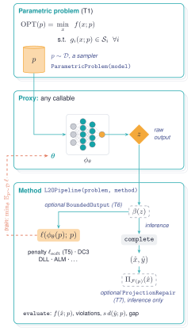

```@meta
CurrentModule = LearningToOptimize
```

# LearningToOptimize.jl

```@raw html
<p class="eyebrow">Parametric datasets · Sensitivity labels · Optimization proxies</p>
<figure class="fig hero has-compact">
```
![How an optimization proxy is trained and used. Parametric problem: OPT of p is the minimum over x of f of x and p subject to g_i of x and p in S_i, with p drawn by a sampler. Proxy: a network phi_theta maps p to a raw output z. Method: an optional BoundedOutput layer, then either the training loss ell of phi_theta of p and p, or at inference complete, giving x-hat and y-hat, and an optional ProjectionRepair; evaluate reports objective, violations, dual bound and gap. A dashed arrow returns the gradient of the expected loss to theta.](assets/diagrams/learningtooptimize--method.svg)


```@raw html
<figcaption><i>A proxy maps the parameters of a JuMP model to a raw output; each method turns that output into a training loss, or completes it into a prediction at inference, with optional repair layers.</i></figcaption>
</figure>
<p class="lede"><b>LearningToOptimize.jl</b> trains <i>optimization proxies</i>: machine-learning models that map the parameters of a parametric optimization problem, written in JuMP, to (near-)optimal primal and/or dual solutions, orders of magnitude faster than a solver. It provides the layer every learning-to-optimize (L2O) method shares (a problem wrapper with fixed input and output layouts, dataset generation, and batched evaluation of objectives, violations and dual bounds), so a new method implements only what is specific to it.</p>
```

The reference method shipped here is the penalty ("soft loss") approach, eq. (2) of [Donti, Rolnick & Kolter, ICLR 2021](https://arxiv.org/abs/2104.12225);
methods with completion steps (feasibility restoration, dual completion) live in sibling packages. See the [survey by Kotary et al. (IJCAI 2021)](https://arxiv.org/abs/2103.16378) for the field, and our
[Hugging Face organization](https://huggingface.co/LearningToOptimize) for datasets, pre-trained models and benchmarks.

## Installation

The API described here is on the development version. The registered LearningToOptimize 1.0.0 predates it
(it has no `L2OCore`, `ParametricProblem` or `L2OPipeline`). Until the next release, install the core
subpackage first and then the main package, on any Julia version from 1.10:

```julia
using Pkg
Pkg.add(url = "https://github.com/LearningToOptimize/LearningToOptimize.jl", subdir = "lib/L2OCore")
Pkg.add(url = "https://github.com/LearningToOptimize/LearningToOptimize.jl")
```

The example below also needs JuMP, HiGHS and Flux: `Pkg.add(["JuMP", "HiGHS", "Flux"])`.

## Minimal example

```julia
using LearningToOptimize, JuMP, HiGHS, Flux, Random

model = Model()
@variable(model, d[1:2] in MOI.Parameter.([1.0, 2.0]))   # parameters
@variable(model, 0 <= g[1:3] <= 4)
@constraint(model, g[1] + g[2] == d[1])
@constraint(model, g[3] == d[2])
@objective(model, Min, g[1] + 3g[2] + 2g[3])

problem = ParametricProblem(model)                       # detects LinearConic
pipe = L2OPipeline(problem, PenaltyMethod())
sampler = BoxSampler([0.5, 1.0], [1.5, 2.0])
train = generate_data(pipe; sampler, n = 128)            # self-supervised: parameters only
test = generate_data(pipe; sampler, n = 32, optimizer = HiGHS.Optimizer)

proxy = Flux.f64(Chain(Dense(2 => 32, relu), Dense(32 => 3)))
train_flux!(pipe, proxy, train; epochs = 200, optimiser = Flux.Optimisers.Adam(1e-2))

prediction = complete(pipe, test.inputs, proxy(test.inputs))
evaluate(pipe, test.inputs, prediction)                  # objective, violations, gaps
```

## What you need to provide

- A JuMP model whose instance data are parameters (`@variable(model, p in MOI.Parameter(value))`).
- A parameter distribution: `BoxSampler`, `ScaledSampler`, or any function `(rng, n) -> matrix`.
- A proxy: any callable mapping a `num_parameters × batch` matrix to the method's output (Flux, Lux, plain Julia).
- A solver, only for methods (or evaluations) that need labels or reference optima.

## Where to go next

- **[Theory](theory.md)**: notation, batched evaluation, the Lagrangian dual
  bound and the penalty method.
- **[Design](design.md)**: how the ecosystem is organized (`lib/L2OCore`,
  method packages), the type hierarchy, data flow and method lifecycle.
- **[Getting started](examples/penalty_lp.md)**: train a penalty proxy for a
  small LP in seconds.
- **[Adding a method](guide/extending.md)**: what a method package implements.
- **[Dataset generation with solver labels](datasetgen.md)**: `ProblemIterator`,
  recorders, samplers, and training Flux or MLJ models on the saved files.

## The LearningToOptimize ecosystem

| Package | What it provides |
|:--|:--|
| [LearningToOptimize.jl](https://github.com/LearningToOptimize/LearningToOptimize.jl) | the penalty method, Flux training and solver-labeled dataset generation; hosts the two subpackages below |
| ↳ [L2OCore](https://github.com/LearningToOptimize/LearningToOptimize.jl/tree/main/lib/L2OCore) | the shared interface: method families, problem wrapper, batched evaluators, datasets |
| ↳ [L2OSobolev](https://github.com/LearningToOptimize/LearningToOptimize.jl/tree/main/lib/L2OSobolev) | derivative (Sobolev) supervision added to any method |
| [L2ODLL.jl](https://github.com/LearningToOptimize/L2ODLL.jl) | Dual Lagrangian Learning: dual proxies that give valid dual bounds for conic problems |
| [L2ODC3.jl](https://github.com/LearningToOptimize/L2ODC3.jl) | DC3: equality completion and inequality correction for primal proxies |
| [L2OALM.jl](https://github.com/LearningToOptimize/L2OALM.jl) | primal-dual learning with an augmented Lagrangian |
