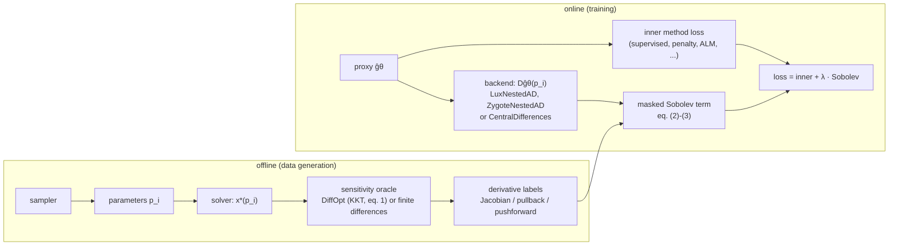

# Sobolev supervision: package guide

`L2OSobolev` (in `lib/L2OSobolev` of this repository) adds derivative
supervision to **any** `L2OCore` method whose proxy predicts primal variables.
The method, its derivative labels and the approximation results are on the
[theory page](@ref "Theory: Sobolev (derivative) supervision"); a runnable
example is [Sobolev-regularized proxy for a parametric QP](@ref).



## Getting started

```julia
using L2OCore, L2OSobolev, JuMP, HiGHS, DiffOpt, Lux

problem = ParametricProblem(model)            # JuMP model with MOI.Parameter
method  = SobolevRegularized(SupervisedMSE();  # any primal / primal-dual method
                             weight = 1.0,
                             mask = RandomMask(0.1),
                             directions = FullJacobian(),
                             backend = LuxNestedAD())
pipe = L2OPipeline(problem, method)
data = generate_data(pipe; sampler, n = 1000, optimizer = HiGHS.Optimizer)
# in the training loop (sm = StatefulLuxLayer of the proxy):
ℓ = loss(pipe, X, sm(X); targets = batch, proxy = sm)
```

The same pipeline trains a Flux model with exact derivatives through
[`ZygoteNestedAD`](@ref L2OSobolev.ZygoteNestedAD) (Zygote inside the loss
and for the gradient with respect to the weights):

```julia
using L2OCore, L2OSobolev, JuMP, HiGHS, DiffOpt, Flux, Zygote

method = SobolevRegularized(SupervisedMSE(); weight = 1.0, backend = ZygoteNestedAD())
pipe = L2OPipeline(problem, method)
data = generate_data(pipe; sampler, n = 1000, optimizer = HiGHS.Optimizer)
X = data.inputs
nin, nout = num_parameters(problem), num_decision_variables(problem)
model = Flux.f64(Chain(Dense(nin => 32, tanh), Dense(32 => nout)))
opt = Flux.setup(Adam(5e-3), model)
for epoch = 1:500
    g = Flux.gradient(m -> loss(pipe, X, m(X); targets = data, proxy = m), model)[1]
    Flux.update!(opt, model, g)
end
```

`train_flux!` from LearningToOptimize runs the same loop with mini-batches
(it passes `proxy = model` to `loss`).

## Concepts

| concept | type | role |
|:--|:--|:--|
| wrapper | [`SobolevRegularized`](@ref L2OSobolev.SobolevRegularized) | `loss = inner loss + weight · sobolev_loss`; everything else is the inner method's |
| directions | [`FullJacobian`](@ref L2OSobolev.FullJacobian), [`RandomPullbacks`](@ref L2OSobolev.RandomPullbacks), [`RandomPushforwards`](@ref L2OSobolev.RandomPushforwards) | which derivative labels `generate_data` records |
| oracle | [`DiffOptSensitivities`](@ref L2OSobolev.DiffOptSensitivities), [`FiniteDifferenceSensitivities`](@ref L2OSobolev.FiniteDifferenceSensitivities) | where labels come from (`generate_data(...; oracle)`) |
| labels | `JacobianLabels`, `PullbackLabels`, `PushforwardLabels` (in `L2OCore`) | optional `ds.derivatives` field of the dataset |
| mask | [`DenseMask`](@ref L2OSobolev.DenseMask), [`RandomMask`](@ref L2OSobolev.RandomMask), [`FixedMask`](@ref L2OSobolev.FixedMask) | which entries are matched per loss evaluation |
| backend | [`LuxNestedAD`](@ref L2OSobolev.LuxNestedAD), [`ZygoteNestedAD`](@ref L2OSobolev.ZygoteNestedAD), [`CentralDifferences`](@ref L2OSobolev.CentralDifferences) | how proxy input derivatives are computed inside the loss |
| map | [`ProxyMap`](@ref L2OSobolev.ProxyMap) | raw primal output, or completed primal (`through_completion = true`) |

Labels are optional in the data layer: `L2ODataset.derivatives` is `nothing`
unless an oracle filled it, and datasets with labels work unchanged with any
other method. `label_errors` compares labels with finite differences of the
solver map and flags degenerate samples.

## Composing with methods

| inner method | value term | what Sobolev adds | notes |
|:--|:--|:--|:--|
| `SupervisedMSE` | solver labels | eq. (2) of the paper exactly | |
| penalty (`PenaltyMethod` in LearningToOptimize) | self-supervised | local solver information beyond the objective | "semi-self-supervised" setting of the paper; labels still need a solver |
| augmented Lagrangian / primal-dual learning | self-supervised | as above, on the primal rows | primal-dual raw outputs: only primal rows are supervised |
| completion / repair (e.g. DC3) | method's loss | derivatives *through* the completion | `through_completion = true` with `CentralDifferences()` |
| dual methods (e.g. DLL) | — | not supported (labels are primal sensitivities) | constructor throws |

## Machine-learning frameworks and nested AD

The Sobolev term differentiates the proxy with respect to its *inputs* inside
a loss that is then differentiated with respect to the *weights*. Measured
behavior (see the design page for the full matrix and
`dev/nested_ad_matrix.jl`):

| proxy | backend | outer AD | status |
|:--|:--|:--|:--|
| Lux `StatefulLuxLayer` | `LuxNestedAD()` | Zygote | exact; tested |
| Flux `Chain`, closure over Flux parameters, any Zygote-differentiable function | `ZygoteNestedAD()` | Zygote | exact; tested (including Flux training) |
| any callable (Lux, Flux, function) | `CentralDifferences()` | Zygote (or any AD) | ``O(h^2)`` approximation of the inner derivative; tested |
| completion layer around any proxy | `CentralDifferences()`, `through_completion = true` | Zygote | tested |
| Lux layer wrapped in a closure | `LuxNestedAD()` | Zygote | **fails** (Lux's rules need the layer itself): use `CentralDifferences()` |
| completion layer around any proxy | `ZygoteNestedAD()`, `through_completion = true` | Zygote | rejected (Zygote cannot differentiate completion layers twice in general): use `CentralDifferences()` |
| any | `ForwardDiff` inside a Zygote loss | Zygote | **silently wrong** (`nothing` gradients): never do this |

**Recommendation:** for exact derivatives, Lux with `LuxNestedAD()` or Flux
(or any Zygote-differentiable callable) with `ZygoteNestedAD()`; both are
supported and tested against finite differences. `CentralDifferences()` works
with any proxy and any outer AD, and is the backend for derivatives through
completion layers.

## GPUs

- `sobolev_loss`, the masks and `CentralDifferences` use only broadcasts,
  reshapes and reductions; masks and directions are copied to the array type of
  the inputs (`similar` + `copyto!`), so they run on GPU arrays without scalar
  indexing.
- `LuxNestedAD` uses Lux's helpers, which support GPU devices.
- `ZygoteNestedAD` uses Zygote pullbacks of the proxy, `repeat`, reshapes and
  broadcasts; its seeds are copied to the array type of the inputs, so it runs
  wherever the proxy's Zygote rules do (e.g. Flux layers on GPU arrays). CI
  tests it on the CPU.
- Label generation with DiffOpt runs on the CPU, one instance at a time. A GPU
  oracle (batched KKT solves for ExaModels/MadNLP problems) plugs in through
  the oracle extension point below.

## Extension points

Everything is extended by dispatch on abstract types.

**A new mask** (e.g. structure-aware masking):

```julia
struct TopRowsMask <: L2OSobolev.AbstractDerivativeMask
    rows::Vector{Int}
end
function L2OSobolev.sample_mask(m::TopRowsMask, rng, dims::Dims)
    M = falses(dims)
    M[m.rows, :] .= true
    return Array{Bool}(M)
end
```

**A new backend** (e.g. another nested-AD system): subtype
[`AbstractSobolevBackend`](@ref L2OSobolev.AbstractSobolevBackend) and
implement [`proxy_jacobian`](@ref L2OSobolev.proxy_jacobian),
[`proxy_pushforward`](@ref L2OSobolev.proxy_pushforward) and
[`proxy_pullback`](@ref L2OSobolev.proxy_pullback) for the map types you
support; results must be differentiable by the outer AD.

**A new oracle** (e.g. GPU or batched solvers): subtype
[`AbstractSensitivityOracle`](@ref L2OSobolev.AbstractSensitivityOracle) and
implement

```julia
L2OSobolev.sensitivity_labels(o::MyOracle, problem, inputs, directions; rng)
    -> (; labels, primal, ok)
```

for the directions you support. `generate_data(pipe; oracle = MyOracle(...))`
uses it, and the test pattern of `test_labels.jl` (`label_errors` against
finite differences) applies unchanged.

**A new label type:** subtype `L2OCore.AbstractDerivativeLabels` (add
subsetting in `L2OCore`) and add a `sobolev_loss` method.
