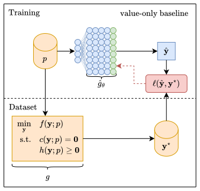
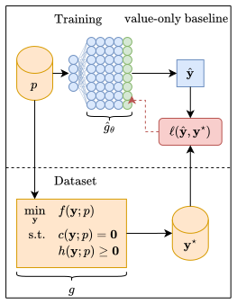
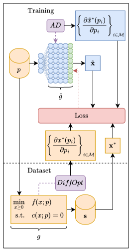
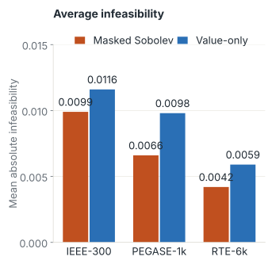
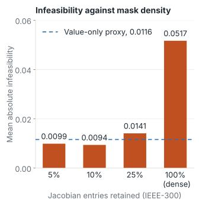

# Theory: Sobolev (derivative) supervision

This page states the method implemented by `lib/L2OSobolev` as an optimization
problem, the conditions under which its derivative labels are the derivatives of
the solution map, and the approximation results of the paper. Equation numbers in the form "eq. (n) of [R26]"
refer to the paper below; numbers in the form (S n) are local to this page.

> [R26] A. W. Rosemberg, J. Dias Garcia, R. Bent, P. Van Hentenryck.
> *Masked Sobolev Training for Feasibility-Reliable Optimization Proxies.*
> Advances in Neural Information Processing Systems (NeurIPS), 2026.

## Setting and notation

A parametric optimization problem with parameters ``p ∈ \mathcal P ⊂ ℝ^d``
and decision variables ``x ∈ ℝ^n``,

```math
g(p) = x^\star(p) ∈ \arg\min_x \; \{\, f(x; p) \;:\; c(x; p) = 0,\; h(x; p) ≤ 0 \,\},
\tag{S1}
```

defines the **solution map** ``g : \mathcal P → ℝ^n``. An optimization proxy
``\hat g_θ : ℝ^d → ℝ^n`` (a neural network with weights ``θ``) approximates
``g``. Its Jacobian is ``D\hat g_θ(p) ∈ ℝ^{n×d}`` and the solver sensitivity
is ``Dg(p) = ∂x^\star/∂p ∈ ℝ^{n×d}``.

| symbol | meaning | code |
|:--|:--|:--|
| ``p_i``, ``N`` | sampled parameters, number of samples | `ds.inputs` (`d × N`) |
| ``g(p_i)`` | solver solution (value label) | `ds.primal` (`n × N`) |
| ``Dg(p_i)`` | solver sensitivity (derivative label) | `ds.derivatives` |
| ``\hat g_θ`` | proxy map (primal prediction) | [`ProxyMap`](@ref L2OSobolev.ProxyMap) |
| ``\mathcal M ∈ \{0,1\}^{n×d}`` | derivative mask | [`AbstractDerivativeMask`](@ref L2OSobolev.AbstractDerivativeMask) |
| ``λ`` | Sobolev weight | `SobolevRegularized(...; weight)` |

## Derivative labels from KKT sensitivity

Collect the primal-dual solution in ``s = (x, ν, μ)`` (multipliers of the
equalities and inequalities). A KKT point satisfies ``F(s^\star, p) = 0`` with

```math
F(s, p) = \begin{pmatrix}
  ∇_x f(x;p) + ∇_x c(x;p)^⊤ ν + ∇_x h(x;p)^⊤ μ \\
  c(x;p) \\
  \operatorname{diag}(μ)\, h(x;p)
\end{pmatrix},
\qquad μ ≥ 0,\; h(x;p) ≤ 0 .
\tag{S2}
```

**Theorem (Fiacco, 1976).** Let ``f, c, h`` be ``C^2`` near ``(x^\star, p_0)``
and assume at ``s^\star = s^\star(p_0)``: the linear independence constraint
qualification (LICQ), the second-order sufficient conditions (SOSC) and strict
complementarity (``μ_j > 0`` for every active inequality). Then on a
neighborhood of ``p_0`` the KKT point ``s^\star(p)`` is unique, continuously
differentiable, the active set does not change, and

```math
∇_p s^\star = -\big(∇_s F(s^\star, p)\big)^{-1}\, ∇_p F(s^\star, p).
\tag{S3}
```

(S3) is eq. (1) of [R26]; ``Dg(p)`` is its ``x`` block. Computing it is one
linear solve with the KKT Jacobian per direction:

- **forward mode** (Jacobian–vector product): ``Dg(p)\,v = -[∇_s F^{-1} ∇_p F\, v]_x``,
  one solve per parameter direction ``v``;
- **reverse mode** (vector–Jacobian product): solve ``∇_s F^⊤ z = (w, 0, 0)`` and
  return ``w^⊤ Dg(p) = -z^⊤ ∇_p F``, one solve per output seed ``w``.

[`DiffOptSensitivities`](@ref L2OSobolev.DiffOptSensitivities) computes these
with DiffOpt.jl; a full Jacobian costs `n` reverse (or `d` forward) solves,
a directional label one solve.

**Linear and convex quadratic programs.** For LPs and convex QPs with
parameters in the right-hand side and linear cost, ``g`` is piecewise affine:
inside a *critical region* (fixed non-degenerate active set) ``Dg`` is constant,
and on region boundaries ``g`` is not differentiable. Sensitivities are
therefore exact local derivatives at almost every sample, and carry no
information about neighbouring regions.

**Directional labels.** Instead of the full ``Dg(p_k)``, a sample may carry a
pullback ``(w_k, Dg(p_k)^⊤ w_k)``
([`PullbackLabels`](@ref L2OCore.PullbackLabels), one reverse solve) or a
pushforward ``(v_k, Dg(p_k) v_k)``
([`PushforwardLabels`](@ref L2OCore.PushforwardLabels), one forward solve).
With one-hot seeds these are a random row or column of the Jacobian: a
sparse, stochastic subset of its entries chosen *when the data is labeled*.

## Masked Sobolev loss

```@raw html
<figure class="fig has-compact">
```



```@raw html
<figcaption><b>With $\lambda = 0$, (S4) is value matching.</b> The solver only labels data: each sampled $p_i$ is solved for $g(p_i)$, and the proxy is fitted to these labels.</figcaption>
</figure>
```

```@raw html
<figure class="fig has-compact">
```



```@raw html
<figcaption><b>The masked derivative term adds the solver's local response.</b> In the dataset lane each sampled $p_i$ is solved and DiffOpt returns the selected sensitivities; in the training lane automatic differentiation returns the matching entries of the proxy Jacobian, and the loss combines the value term with the masked derivative term. Figure 1 of [R26].</figcaption>
</figure>
```

Both figures are from the paper's website and keep its symbols. The first writes the decision as $\mathbf y$ (here $x$) and the inequalities as $h(\mathbf y; p) \ge 0$ (here $-h \le 0$ in (S1)); in the second, $\mathbf x^*$ and $\tilde{\mathbf x}$ are $g(p_i)$ and $\hat g_\theta(p_i)$, and $\mathbf s$ is the store of solved instances.

Given tuples ``(p_i, g(p_i), Dg(p_i))``, the first-order masked Sobolev loss is

```math
\mathcal L(θ) = \frac1N \sum_{i=1}^N \ell\big(\hat g_θ(p_i), g(p_i)\big)
  + \frac{λ}{N} \sum_{i=1}^N \ell_d\big(\mathcal M ⊙ D\hat g_θ(p_i),\, \mathcal M ⊙ Dg(p_i)\big),
\tag{S4}
```

(eq. (2) of [R26]) with the normalized masked squared error

```math
\ell_d\big(\mathcal M ⊙ D\hat g_θ(p_i), \mathcal M ⊙ Dg(p_i)\big)
  = \frac{\big\|\mathcal M ⊙ \big(D\hat g_θ(p_i) - Dg(p_i)\big)\big\|_F^2}{\|\mathcal M\|_0}
\tag{S5}
```

(eq. (3) of [R26]). If ``\mathcal M`` is drawn uniformly among the masks with
exactly ``k`` ones, each entry is kept with probability ``k/(nd)``, so

```math
\mathbb E_{\mathcal M}[\ell_d] = \frac{1}{nd}\, \big\|D\hat g_θ(p_i) - Dg(p_i)\big\|_F^2
\tag{S6}
```

(eq. (4) of [R26]): ``λ`` sets the strength of derivative supervision and the
mask density only sets *how many* matching conditions enter one update. [R26]
uses the mask as an algorithmic control: dense matching can over-constrain the
proxy where neighbouring samples have conflicting active-set sensitivities,
and keeping 5–10% of the entries gave lower infeasibility on AC-OPF (Table 2
of [R26]; its reported settings use densities of 5–25%, weights
``λ ∈ [0.1, 4.35]`` and mini-batches of 32).

```@raw html
<figure class="fig pair">
```
 
```@raw html
<figcaption><b>Where active sets multiply, derivative labels lower the mean infeasibility moderately and the worst case far more.</b> Mean: absolute infeasibility absolute infeasibility on three AC-OPF networks, about 15–33% lower (Table 1 of [R26]). Worst case: for each test instance, the largest constraint violation of the value-only proxy minus that of the Sobolev proxy, normalized by the largest Sobolev violation on the test set; above zero the Sobolev proxy has the smaller worst case. It has the larger one on fewer than 15% of instances, and the medians are about 18%, 400% and 180% (Figure 3 of [R26], redrawn from the paper's figure). Published results; this package implements the method and does not re-run these experiments.</figcaption>
</figure>
<figure class="fig inset">
```

```@raw html
<figcaption><b>Only sparse masks help.</b> Mean absolute infeasibility on IEEE-300 against the share of Jacobian entries retained; dense matching is worse than no derivative labels. Published results of [R26], Tables 1 and 2.</figcaption>
</figure>
```

The same estimator applies to directional labels: for pullbacks the mask acts
on the ``d`` entries of ``Dg^⊤ w``, for pushforwards on the ``n`` entries of
``Dg\, v``. With seeds ``w`` uniform over the ``n`` unit vectors,

```math
\mathbb E_w\Big[\tfrac1d \big\|(D\hat g_θ - Dg)^⊤ w\big\|_2^2\Big]
  = \frac{1}{nd}\big\|D\hat g_θ - Dg\big\|_F^2 ,
\tag{S7}
```

and likewise for one-hot directions ``v``. The same holds for seeds drawn
uniformly on the unit sphere, since then ``\mathbb E[w w^⊤] = I/n`` (and
``\mathbb E[v v^⊤] = I/d``). Directional labels are therefore unbiased for the
dense loss in expectation over the labeling, and a random mask on top of them
keeps this property.

**Structured masks.** A mask that keeps ``k`` of the ``d`` columns of the
Jacobian uniformly at random
([`RandomColumnMask`](@ref L2OSobolev.RandomColumnMask)) keeps each entry with
probability ``k/d``; one that keeps ``k`` of the ``n`` rows
([`RandomRowMask`](@ref L2OSobolev.RandomRowMask)) with probability ``k/n``.
Every mask of either kind has the same ``\|\mathcal M\|_0`` (``kn`` or ``kd``),
so normalizing by it as in (S5) again gives the dense loss (S6) in expectation.
With full-Jacobian labels, only the selected columns ``D\hat g_θ e_j`` (``k``
Jacobian–vector products) or rows ``e_i^⊤ D\hat g_θ`` (``k`` vector–Jacobian
products) of the proxy are needed. The loss computes only those, except for
row masks with `CentralDifferences`, which differentiates column by column and
therefore computes the full Jacobian.

### Composition with other methods

[R26] describes the value term of (S4) as interchangeable: the derivative term
complements self-supervised objectives (its "semi-self-supervised" variant)
and can be applied before or through a repair/completion layer.
[`SobolevRegularized`](@ref L2OSobolev.SobolevRegularized) implements exactly
this by replacing the first sum of (S4) by the loss of the wrapped method
``\mathcal L_{\text{inner}}``:

```math
\mathcal L(θ) = \mathcal L_{\text{inner}}(θ)
  + \frac{λ}{N} \sum_{i=1}^N \ell_d\big(\mathcal M ⊙ D\hat x_θ(p_i),\, \mathcal M ⊙ Dg(p_i)\big),
\tag{S8}
```

where ``\hat x_θ`` is either the raw primal output of the proxy (``\hat g_θ``,
the default) or the completed primal prediction
``\hat x_θ(p) = \mathrm{complete}(p, \hat g_θ(p))``
(`through_completion = true`, chain rule through the completion layer). With
[`SupervisedMSE`](@ref L2OCore.SupervisedMSE) as the inner method, (S8) is
exactly (S4) with ``\ell`` the mean squared error.

### Computing the proxy derivatives (nested differentiation)

The weights are trained by differentiating (S8) with respect to ``θ``, and
(S8) itself contains input derivatives of ``\hat g_θ``: second-order mixed
derivatives ``∂_θ ∂_p \hat g_θ`` are needed. Three backends are provided:

- [`LuxNestedAD`](@ref L2OSobolev.LuxNestedAD): exact ``D\hat g_θ`` via Lux's
  `batched_jacobian`, `jacobian_vector_product` and `vector_jacobian_product`,
  which Lux differentiates again under Zygote (forward-over-reverse rules);
- [`ZygoteNestedAD`](@ref L2OSobolev.ZygoteNestedAD): exact ``D\hat g_θ`` of a
  Flux model or any other Zygote-differentiable callable via Zygote pullbacks
  (reverse over reverse): ``D\hat g_θ^⊤ w`` is one pullback, the full Jacobian
  one pullback of width ``nB`` with the ``n`` unit seeds, and
  ``D\hat g_θ v`` the Jacobian applied to ``v``;
- [`CentralDifferences`](@ref L2OSobolev.CentralDifferences):
  ``D\hat g_θ v ≈ (\hat g_θ(p + hv) - \hat g_θ(p - hv))/2h`` with truncation error
  ``O(h^2 \|D^3 \hat g_θ\|)`` and rounding error
  ``O(ε(\|\hat g_θ\| + \|D\hat g_θ\|\,\|p\|_∞)/h)``, balanced by the default
  ``h = ε^{1/3}\max(1, \|P\|_∞)``. The outer AD only differentiates forward
  passes (works for any proxy and any AD, and through completion layers); its
  weight gradient is that of the approximate loss, which agrees with the exact
  nested-AD gradient up to the same ``O(h^2)`` error.

The networks of [R26] use ReLU, sigmoid and LeakyReLU activations. For
piecewise-linear activations ``D\hat g_θ`` exists almost everywhere and is
differentiable in ``θ`` almost everywhere, so the loss is still trainable, but
``D\hat g_θ`` is not Lipschitz and the Jacobian-Lipschitz condition of the
next section does not hold for the proxy; Theorem 3 then does not apply as
stated.

## Approximation bounds (regular regime)

Let ``\mathcal P`` be compact and convex, ``\mathcal T = \{p_i\}_{i=1}^N ⊂ \mathcal P``
and ``δ = \sup_{p ∈ \mathcal P} \min_i \|p - p_i\|`` the covering radius.
Theorems 1–3 of [R26] compare proxies that interpolate the samples exactly.
If ``g`` and ``\hat g_θ`` are Lipschitz with constants ``L_g`` and
``L_{\hat g}``, value interpolation bounds the value error by ``δ`` (Theorem 1).
If both are ``C^1`` on ``\mathcal P`` with Jacobians Lipschitz with constants
``M_g`` and ``M_{\hat g}``, Jacobian interpolation bounds the Jacobian error by
``δ`` (Theorem 2), and interpolating both values and Jacobians bounds the value
error by ``δ^2`` (Theorem 3). ``δ`` can be estimated on a test set with
[`covering_radius`](@ref L2OSobolev.covering_radius).

| supervision | interpolation | bound on ``\sup_{p∈\mathcal P}`` |
|:--|:--|:--|
| values (Thm. 1) | ``\hat g_θ(p_i) = g(p_i)`` | ``\|\hat g_θ(p) - g(p)\| ≤ (L_g + L_{\hat g})\,δ`` |
| Jacobians (Thm. 2) | ``D\hat g_θ(p_i) = Dg(p_i)`` | ``\|D\hat g_θ(p) - Dg(p)\| ≤ (M_g + M_{\hat g})\,δ`` |
| both (Thm. 3) | both | ``\|\hat g_θ(p) - g(p)\| ≤ \tfrac12 (M_g + M_{\hat g})\,δ^2`` |

Theorem 3 follows from a first-order Taylor expansion around the nearest
sample: zeroth- and first-order terms cancel and the remainders are bounded by
``\tfrac12 M\|h\|^2``. **These are approximation bounds for idealized
interpolants, not convergence results for training with (S4)**: the
practical loss does not reach exact interpolation and masking matches a subset
of entries per update. The Jacobian-Lipschitz condition holds for ``g`` inside
a region where the active set is constant and the Fiacco conditions hold
(Remark 1 of [R26]); networks with smooth activations (`tanh`, `softplus`)
satisfy it on compact sets. Across active-set changes ``Dg`` jumps, and
derivative supervision only helps when neighbouring sensitivities are similar.

## Failure modes

- **Degenerate samples** (weakly active constraints, ``p`` on a critical-region
  boundary): no derivative exists; the KKT matrix is singular or the result is
  one one-sided derivative. [`label_errors`](@ref L2OSobolev.label_errors)
  compares labels with central differences of the solver map and flags such
  samples (for example an LP sampled at a kink), and
  `generate_data(...; max_label_error)` drops them.
- **Non-unique or local solutions** (dual-degenerate LPs, nonconvex NLPs): the
  derivative may belong to another solution branch than the value label.
  `generate_data` drops samples whose oracle solution differs from the value
  label (`consistency_atol`).
- **Highly local sensitivities**: when active sets change on a scale smaller
  than the sample spacing, ``Dg`` carries little information about neighbours;
  [R26] observed less benefit than value-only training in a mean–variance
  portfolio study. Lower `weight` or mask density, or do not use the term.
- **Parameters only in a linear cost (LP)**: the optimal vertex is constant
  inside each region, so the sensitivities are zero and carry no
  interpolation information ([R26], Sec. 5.3).
- **Failed samples kept** (`drop_failed = false`): their labels are `NaN`, and
  `NaN` entries poison the loss even where the mask is zero
  (``0 · \mathrm{NaN} = \mathrm{NaN}``); keep the default or filter them.
- **Integer decisions**: the solution map is piecewise constant;
  sensitivities are zero or undefined. `SobolevRegularized` does not refuse
  `MixedInteger` problems if the inner method supports them, but the labels
  are not meaningful there.

## Deviations from [R26], and why

- The value term of (S4) is the wrapped method's loss (S8), so the same
  regularizer composes with supervised, self-supervised and completion-based
  methods by dispatch. With `SupervisedMSE` it is exactly (S4).
- One mask is drawn per loss evaluation and shared by the batch, matching the
  single ``\mathcal M`` of eq. (2) of [R26].
- Directional (pullback/pushforward) labels are an addition: they record one
  solver sensitivity solve per sample instead of a full Jacobian, and are
  unbiased for the dense loss with one-hot seeds (S7).
- [`CentralDifferences`](@ref L2OSobolev.CentralDifferences) approximates
  ``D\hat g_θ`` (error ``O(h^2)``) to support any ML framework and AD; use
  [`LuxNestedAD`](@ref L2OSobolev.LuxNestedAD) (Lux) or
  [`ZygoteNestedAD`](@ref L2OSobolev.ZygoteNestedAD) (Flux or any
  Zygote-differentiable callable) for exact derivatives.
- DiffOpt labels default to reverse mode: with DiffOpt 0.6 we measured wrong
  forward-mode sensitivities for parameters inside inequality constraints
  (reverse mode and DiffOpt 0.5 agree with finite differences); the test suite
  tracks this as a known upstream issue.
