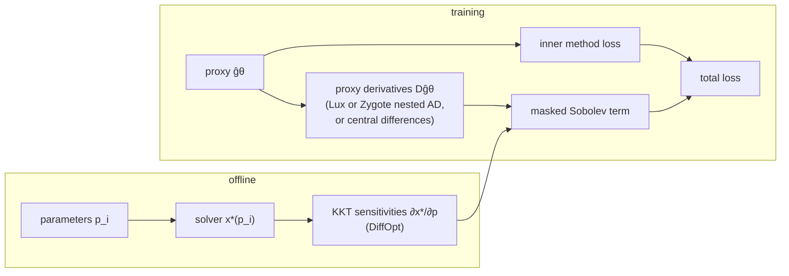

# L2OSobolev.jl

[](https://github.com/LearningToOptimize/LearningToOptimize.jl/actions/workflows/CI.yml?query=branch%3Amain)
[](https://LearningToOptimize.github.io/LearningToOptimize.jl/dev/sobolev/guide/)
[](https://codecov.io/gh/LearningToOptimize/LearningToOptimize.jl)
[](https://github.com/JuliaTesting/Aqua.jl)
[](https://github.com/aviatesk/JET.jl)

**Sobolev (derivative) supervision for optimization proxies, for any learning-to-optimize method.**
An optimization proxy learns the solution map `p ↦ x*(p)` of a parametric problem. Besides matching solver
solutions (values), a Sobolev-trained proxy also matches the solver *sensitivities* `∂x*/∂p`, obtained by implicit
differentiation of the KKT conditions. Following [*Masked Sobolev Training for Feasibility-Reliable Optimization
Proxies*](https://andrewrosemberg.github.io/NeurIPS2026-Masked-Sobolev-Optimization-Proxies/) (Rosemberg, Dias
Garcia, Bent, Van Hentenryck, NeurIPS 2026), only a random subset of the derivative
entries is matched at each update (the mask is an algorithmic control that avoids over-constraining the proxy where
active sets change), and the derivative term is a **regularizer that composes with any method**: supervised
regression, self-supervised penalty or augmented-Lagrangian losses, and completion layers.



## Installation

`L2OSobolev` lives in `lib/L2OSobolev` of the LearningToOptimize.jl repository and depends on `L2OCore`
(`lib/L2OCore`). Neither is registered yet; install L2OCore first, then L2OSobolev, on any Julia version from 1.10:

```julia
using Pkg
Pkg.add(url = "https://github.com/LearningToOptimize/LearningToOptimize.jl", subdir = "lib/L2OCore")
Pkg.add(url = "https://github.com/LearningToOptimize/LearningToOptimize.jl", subdir = "lib/L2OSobolev")
```

Derivative labels from DiffOpt and exact proxy derivatives are package extensions. The example below also needs
`Pkg.add(["JuMP", "HiGHS", "DiffOpt", "Lux", "Zygote", "Optimisers", "ComponentArrays"])`; for a Flux model, add
`Flux` and `Zygote` instead of `Lux`.

## Minimal example

```julia
using L2OCore, L2OSobolev, JuMP, HiGHS, DiffOpt, Lux, Zygote, Optimisers, ComponentArrays, Random

model = Model()
@variable(model, p[1:3] in MOI.Parameter.(zeros(3)))
@variable(model, x[1:4] >= -5)
@constraint(model, sum(x) == 1 + p[3])
@objective(model, Min, sum((i + 1) * x[i]^2 for i in 1:4) - p[1] * x[1] - p[2] * x[2] + 0.5p[3] * x[4])
problem = ParametricProblem(model)

method = SobolevRegularized(SupervisedMSE(); weight = 1.0, mask = RandomMask(0.25), backend = LuxNestedAD())
pipe = L2OPipeline(problem, method)
data = generate_data(pipe; sampler = BoxSampler(-ones(3), ones(3)), n = 8, optimizer = HiGHS.Optimizer)

net = Lux.Chain(Lux.Dense(3 => 32, tanh), Lux.Dense(32 => 4))
ps, st = Lux.setup(Xoshiro(1), net); ps = ComponentArray(ps)
opt = Optimisers.setup(Optimisers.Adam(5e-3), ps)
X = Float32.(data.inputs)
for _ in 1:800
    g = Zygote.gradient(θ -> (sm = StatefulLuxLayer{true}(net, θ, st);
                              loss(pipe, X, sm(X); targets = data, proxy = sm)), ps)[1]
    global opt, ps = Optimisers.update!(opt, ps, g)
end
```

The [documentation example](https://LearningToOptimize.github.io/LearningToOptimize.jl/dev/examples/sobolev_qp/)
compares this with plain value supervision (several times lower test error from 8 samples).

## What you need to provide

- a JuMP model with `MOI.Parameter`s, wrapped as `ParametricProblem`, and a parameter sampler;
- an inner method from the ecosystem (`SupervisedMSE()`, `PenaltyMethod()`, an augmented-Lagrangian method, …);
- a solver supported by DiffOpt (or any JuMP solver with `FiniteDifferenceSensitivities`);
- a proxy: a Lux `StatefulLuxLayer` (`LuxNestedAD()`) or a Flux model or other Zygote-differentiable
  callable (`ZygoteNestedAD()`) for exact derivatives, or any callable with `CentralDifferences()`, and
  a training loop that passes `proxy = model` to `loss` (with Flux, `train_flux!` from LearningToOptimize does).

## Composition and testing

The derivative term only changes the training loss: supported problem classes, decomposition and completion are
those of the wrapped method, so a completed prediction behaves exactly as with the wrapped method alone. The test
suite in `test/` compares the masked loss with its dense expectation (eq. (4) of the paper), DiffOpt labels with
finite differences of the solver map at regular points (LICQ, SOSC and strict complementarity), nested-AD weight
gradients with finite differences, and checks that `weight = 0` recovers the wrapped method's loss. The method and
its approximation results are on the [theory page](https://LearningToOptimize.github.io/LearningToOptimize.jl/dev/sobolev/theory/).

## The LearningToOptimize ecosystem

| Package | What it provides |
|:--|:--|
| [LearningToOptimize.jl](https://github.com/LearningToOptimize/LearningToOptimize.jl) | the penalty method, Flux training and solver-labeled dataset generation; hosts the two subpackages below |
| ↳ [L2OCore](https://github.com/LearningToOptimize/LearningToOptimize.jl/tree/main/lib/L2OCore) | the shared interface: method families, problem wrapper, batched evaluators, datasets |
| ↳ [L2OSobolev](https://github.com/LearningToOptimize/LearningToOptimize.jl/tree/main/lib/L2OSobolev) | derivative (Sobolev) supervision added to any method |
| [L2ODLL.jl](https://github.com/LearningToOptimize/L2ODLL.jl) | Dual Lagrangian Learning: dual proxies that give valid dual bounds for conic problems |
| [L2ODC3.jl](https://github.com/LearningToOptimize/L2ODC3.jl) | DC3: equality completion and inequality correction for primal proxies |
| [L2OALM.jl](https://github.com/LearningToOptimize/L2OALM.jl) | primal-dual learning with an augmented Lagrangian |

L2OSobolev composes with primal and primal-dual methods. Dual methods such as DLL are not supported, because the
labels are primal sensitivities.

## Citation

```bibtex
@inproceedings{rosemberg2026masked,
  title = {Masked Sobolev Training for Feasibility-Reliable Optimization Proxies},
  author = {Rosemberg, Andrew W. and Garcia, Joaquim Dias and Bent, Russell and Van Hentenryck, Pascal},
  booktitle = {Advances in Neural Information Processing Systems},
  year = {2026}
}
```
